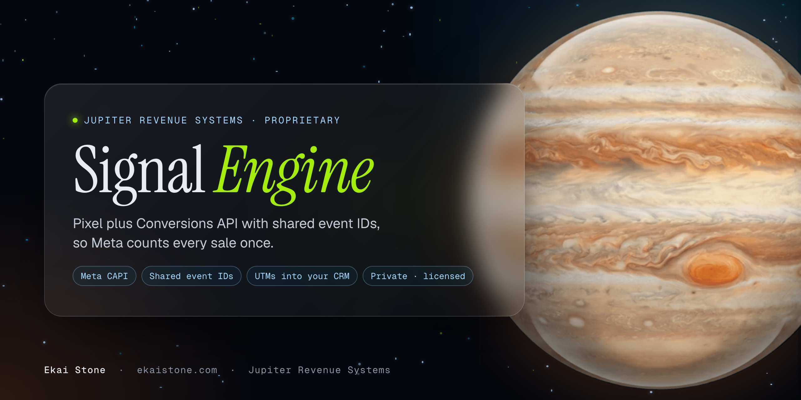

<h1 align="center">Signal Engine</h1>

<b>Pixel plus Conversions API with shared event IDs, so Meta counts every sale once.</b>

  
  
  

---

### What it is

The Signal Engine is the tracking layer behind every Jupiter Revenue Systems build. Your browser pixel and the server side Conversions API send the same purchase with a shared event ID, so Meta counts it once and learns from real sales instead of guesses.

### What it does

- **Browser plus server.** Every key event is sent from the page and from the server, matched by one shared event ID.
- **Counted once.** Purchases are deduplicated, so your ads optimize on real buyers, not double counts.
- **Every customer parameter.** Click ID, browser ID, external ID and hashed contact details go with each event for the strongest match Meta allows.
- **UTMs into your CRM.** The ad, ad set and campaign travel with each lead, so every sale traces back to the ad that made it.
- **Purchases matched.** Checkout, order bumps and one time offers all report as real revenue.
- **CRM agnostic.** It runs beside the CRM you already use.

### How you get it

The Signal Engine isn't sold on its own. It ships inside every [Seven Star Build](https://ekaistone.com/seven-star/build), and each [Seven Star License](https://ekaistone.com/seven-star/license) includes your own Signal Engine tracking instance.

> **Private repository.** The source is proprietary to Jupiter Revenue Systems and isn't public. You own your build on full payment; Jupiter keeps its frameworks, templates and the Signal Engine that runs inside it. [Apply for access](https://ekaistone.com/seven-star/apply).

---

Built by <a href="https://github.com/ekaionjupiter">Ekai Stone</a> · <a href="https://ekaistone.com">ekaistone.com</a> · Jupiter Revenue Systems

